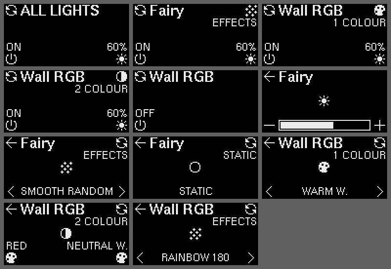

# esphome-ws2812b-hbridge-light-control

A 2-output light controller with OLED screen for controlling WS2812B and 2-wire H-bridge LED lights.

This repo holds the controller's OLED menu: a 128x64 SH1106/SSD1306 screen with four buttons, one at each corner. The same C++ code runs in two builds:

- **ESPHome**, as an external component, controlling the real lights alongside Home Assistant.
- **A UI test firmware** (PlatformIO, no Wi-Fi) with fake lights, for fast UI iteration on the device. It builds in about 15 s and flashes over USB.



## Screens

Each button's icon and label are drawn next to it and change per screen.

| Screen | B1 (top-left) | B2 (bottom-left) | B3 (bottom-right) | B4 (top-right) |
|---|---|---|---|---|
| Home | Next light (All lights, then each light) | On / off | Brightness screen (while on) | Mode screen (single lights, while on) |
| Brightness | Back | Down 10 %, to 0 = off (hold to repeat) | Up 10 % (hold to repeat) | – |
| Mode | Back | Previous colour / effect, or next colour 1 | Next colour / effect, or next colour 2 | Next mode |

- **Modes:** WS2812B lights cycle 1 COLOUR → 2 COLOUR → EFFECTS. H-bridge lights cycle STATIC → EFFECTS. The home screen shows the mode by B4; the mode screen shows the colour or effect.
- **Off:** while the light (or every light, on All lights) is off, B3 and B4 are hidden and do nothing.
- **Brightness:** stepping down to 0 turns the light off, keeping its last brightness for the next turn-on. Up from 0 turns it on at 10 %.
- **All lights:**
  - On/off shows ON if any light is on. A press turns them all off, or all on if all are off.
  - Brightness starts from the brightest light that's on, and the first press sets every light that's on to the same value. Lights that are off stay off, unless all of them are (stepped down to 0): then up turns them all on.
- **Timeout:** submenus return to the home screen after 30 s without a press.

## How it fits together

```
             ┌──────── lcui::Ui (plain C++, no ESPHome / Arduino) ────────┐
press()   ─► │  screens + state machine ──► render(Canvas&)                 │
tick(ms)  ─► │        ▲ reads every frame, writes on press                 │
             │   LightPort[]   ("All lights" is built by the UI)           │
             └──────┬────────────────────────────────┬────────────────────┘
       ESPHome component                    UI test firmware / host tests
       • buttons: binary_sensor callbacks   • buttons: GPIO polling / test calls
       • Canvas: DisplayCanvas on `it`      • Canvas: U8g2 / BDF → PNG
       • LightPort: HBridgePort, StripPort  • LightPort: FakeLight in RAM
```

- **`Canvas`** ([lcui_canvas.h](components/light_control_ui/lcui_canvas.h)) is the drawing surface: text (by baseline), text width, 1-bit bitmaps, rectangles. The caller clears the frame and sends it to the display once per frame.
- **`LightPort`** ([lcui_light.h](components/light_control_ui/lcui_light.h)) is one light as the UI sees it: name, whether it has colour, on/off, brightness (0 = off), mode, effect and colour lists. The UI never sees pins or hardware types.
- **The ESPHome ports** change lights the way Home Assistant does: light calls for on/off, brightness and effects, and the Preset 1/2 selects for colours. The YAML's own automations (`capture_strip_control`, `apply_mode`) keep working unchanged. Light, effect and colour names on the screen are the ones in the YAML.
- **Icons** come from [oled-lcd-icons](https://github.com/simonmetcalfe/oled-lcd-icons) (12x12). **Fonts** are X11 Adobe Helvetica bitmap fonts (helvR08 labels, helvB10 titles), identical in both builds (see [fonts/README.md](fonts/README.md)).

## Repo layout

| Path | What |
|---|---|
| `components/light_control_ui/lcui_*` | The UI: plain C++, shared by every build |
| `components/light_control_ui/light_control_ui.*`, `__init__.py` | ESPHome adapter and config schema |
| `library.json` | Makes the UI a PlatformIO library (core files only) |
| `platformio.ini` | PlatformIO project (repo root): the `ui-test` and `native` environments |
| `src/main.cpp` | UI test firmware |
| `test/` | Host tests (`test_ui`) and preview generator (`test_preview`) |
| `examples/balconylights_ui.yaml` | What to add to `balconylights.yaml` |
| `fonts/` | The two BDF fonts ESPHome loads |
| `docs/preview/` | Generated screen previews |

## ESPHome

See [examples/balconylights_ui.yaml](examples/balconylights_ui.yaml). In short:

```yaml
external_components:
  - source: github://simonmetcalfe/esphome-ws2812b-hbridge-light-control@main
    components: [light_control_ui]
  - source: github://simonmetcalfe/oled-lcd-icons@main
    components: [oli_icons]

light_control_ui:
  display_id: oled_display
  font_small: ui_font_small
  font_large: ui_font_large
  buttons: [button1, button2, button3, button4]
  lights:
    - type: hbridge
      light_id: light1
    - type: ws2812b
      light_id: balcony_strip
      colour1_select: preset_1_select
      colour2_select: preset_2_select
```

The component becomes the display's writer, so the display needs no `lambda:`. It redraws after each button press and on the display's `update_interval`, so changes made in Home Assistant show within that interval.

**To match the hardware**, list each output's light with the type its jumpers select. Up to four lights are supported.

## UI test firmware

Built for the Seeed XIAO ESP32S3, with the pins in `balconylights.yaml`: I2C on GPIO5/6 (D4/D5), buttons on GPIO43, 44, 7 and 8 (D6, D7, D8, D9). The lights are fakes that mirror the balcony (Fairy: 4 effects; Wall RGB: 10 effects, 12 colours), and every change is printed to the USB serial port.

```sh
pio run -e ui-test -t upload    # flash over USB
pio device monitor -e ui-test
```

GPIO43/44 are UART0's pins, used here as buttons B1/B2, so serial output goes over USB only.

## Tests and previews

Both run on the computer, with no device:

```sh
pio test -e native -f test_ui        # behaviour tests
pio test -e native -f test_preview   # redraws docs/preview/*.png from the BDF fonts
```

## Not done yet

- **AUTO** (ON / AUTO / OFF) is left out for now; B2 toggles on/off.
- **Colours from the colour wheel aren't detected.** A colour picked on Home Assistant's colour wheel doesn't change the Preset select, so the OLED keeps showing the last preset. The UI can show CUSTOM, but the ESPHome port doesn't detect it yet.
- **Choosing 1 COLOUR while the strip is off** turns it on in its previous mode, so the first B4 press appears to do nothing. `capture_strip_control` resumes the stored mode when a plain turn-on arrives, as it does for Home Assistant. B4 is now disabled while the light is off, so this only happens if the strip is turned off elsewhere while the mode screen is open.
- **The screen stays on.** There's no screen timeout or burn-in protection.
- **Two WS2812B outputs** need `balconylights.yaml` reworked first: its strip state (globals, scripts, Preset selects) exists once, for one strip.
